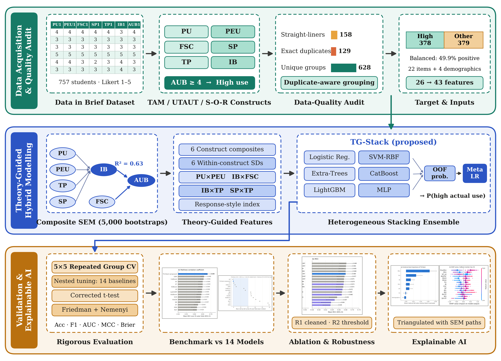

# TG-Stack

**A theory-guided stacking ensemble for explainable prediction of Generation Z social-commerce use behaviour.**

[](https://github.com/<your-username>/tg-stack/actions/workflows/ci.yml)


This repository contains the complete, version-pinned code behind the manuscript
*"TG-Stack: A Theory-Guided Stacking Ensemble for Explainable Prediction of Generation Z Social-Commerce Use
Behaviour"* (in preparation). One command regenerates every number, table and figure of the paper from the open
*Data in Brief* survey of 757 Vietnamese Gen Z university students.

<p align="center"></p>

## Why this project

Most studies of social-commerce adoption explain *intentions* with in-sample structural equation models, and the
few hybrid SEM-ML studies use a single learner, a single hold-out split and ignore survey artefacts. TG-Stack
addresses four weaknesses at once:

| Weakness in prior work | What this project does |
|---|---|
| Single learner (usually one ANN) | **Heterogeneous stacking** of six learners (logistic regression, SVM, Extra-Trees, CatBoost, LightGBM, MLP) under a logistic meta-learner |
| Theory only *selects* inputs | **Theory-guided feature layer** (TAM / UTAUT / S-O-R): construct composites, within-construct dispersion, four theory-specified interactions, a response-style index (26 -> 43 features) |
| Duplicate submissions leak across folds | **Duplicate-aware validation**: identical responses share a group; every split is a *stratified group* k-fold (5 x 5 repeated) |
| Weak baselines and naive significance tests | **14 nested-tuned baselines**, Nadeau-Bengio corrected t-tests, Friedman-Nemenyi ranking, 16-variant ablation, two robustness scenarios, leakage experiment |

Predictions are explained at the *construct* level (grouped permutation importance, SHAP, meta-learner weights) and
triangulated with a bootstrapped composite SEM.

## Headline results (n = 757, 5 x 5 repeated stratified group CV, mean over 25 folds)

TG-Stack uses fixed hyper-parameters; every baseline was tuned in a nested loop.

| Model | Accuracy | F1 | ROC-AUC | MCC | Brier (lower is better) |
|---|:-:|:-:|:-:|:-:|:-:|
| **TG-Stack (proposed)** | **0.840** | **0.839** | 0.907 | **0.680** | **0.121** |
| GBM (tuned) | 0.828 | 0.833 | 0.905 | 0.659 | 0.139 |
| CatBoost (tuned) | 0.827 | 0.829 | 0.899 | 0.656 | 0.125 |
| Random forest (tuned) | 0.824 | 0.829 | 0.907 | 0.650 | 0.123 |
| Logistic regression (tuned) | 0.821 | 0.829 | 0.889 | 0.646 | 0.145 |

* Best on accuracy, F1, MCC, kappa and Brier score; **tied** with the tuned random forest on ROC-AUC.
* Significantly better (Nadeau-Bengio, p < 0.05) than linear, probabilistic, instance-based, kernel, neural, single-tree
  and two boosting learners on at least one primary metric; directionally better than every baseline on accuracy and
  MCC (14/14) but *not* individually significant against the strongest tree ensembles.
* A default random forest looks 0.049 AUC better than it is when duplicate responses leak across folds;
  TG-Stack is insensitive to this artefact.

Full tables (all 15 models, ablation, robustness, leakage, SEM) are in [`docs/RESULTS.md`](docs/RESULTS.md).
These numbers are those reported in the manuscript; reproduce them yourself with the steps below.

## Repository layout

```
tg-stack/
├── src/tg_stack/
│   ├── schema.py          column schema / construct -> item mapping
│   ├── data.py            loading, target construction, duplicate groups, quality audit
│   ├── features.py        TheoryFeatures: the theory-guided sklearn transformer
│   ├── models.py          TG-Stack, its six base learners, the 14 baselines + search spaces
│   ├── evaluation.py      repeated stratified-group CV, nested tuning, summaries
│   ├── metrics.py         8 metrics, Nadeau-Bengio test, Friedman-Nemenyi
│   ├── reproducibility.py version pins and outer-fold MD5 fingerprint
│   ├── stages/            audit | sem | benchmark | ablation | robustness | explain | leakage | figures
│   ├── synthetic.py       schema-compatible *synthetic* data (tests / smoke runs only)
│   └── cli.py             `tg-stack` command
├── tests/                 pytest suite (runs on synthetic data)
├── docs/                  methodology, reproducibility, results, limitations
├── scripts/               make_synthetic_data.py
├── data/                  data instructions + synthetic demo CSV
├── requirements-paper.txt exact pinned environment of the paper
└── pyproject.toml, Makefile, .github/workflows/ci.yml, CITATION.cff, LICENSE
```

## Quick start

### 1. Install

Exact environment of the paper (needed to reproduce the published numbers bit-for-bit):

```bash
python -m venv .venv && source .venv/bin/activate     # Python 3.13 recommended
pip install -r requirements-paper.txt
pip install -e . --no-deps
```

or, for ordinary use/development with flexible versions: `pip install -e ".[dev]"`.

> **scikit-learn 1.9.1 is required for exact reproduction.** `StratifiedGroupKFold(shuffle=True)` assigns folds
> differently in older releases, which changes every cross-validated estimate. The CLI checks the library versions and
> an MD5 fingerprint of the 25 outer folds and stops if either differs from the paper (override with `--no-strict`).

### 2. Get the data

Download the open dataset (see [`data/README.md`](data/README.md)) and save it as
`data/S-COMMERCE_GenZ_UniversityStudent_757_DIB.csv`. The data are not redistributed here.

### 3. Run

```bash
tg-stack --data data/S-COMMERCE_GenZ_UniversityStudent_757_DIB.csv --out results      # everything, ~2-2.5 h on 2 cores
tg-stack --data <csv> --out results --stages main ablation                           # selected stages
tg-stack --data <csv> --out quick --quick                                            # 1 x 5 folds smoke test
python -m tg_stack --help
```

Try the pipeline without the real data (synthetic, **not scientifically meaningful**):

```bash
make demo        # or: tg-stack --data data/synthetic_demo.csv --out results/demo --quick --no-strict --stages audit sem ablation
```

### Stages and where they appear in the paper

| Stage | Produces | Paper |
|---|---|---|
| `audit` | `audit.json` | Table 3 (sample profile, straight-liners, duplicates) |
| `sem` | `sem_measurement.csv`, `sem_htmt.csv`, `sem_structural.csv` | Tables 4-6 |
| `main` | `table_main.csv`, `tests_main.csv`, `folds_main.csv`, `friedman_main.json`, `best_params_main.json`, `oof_main.npz` | Tables 7-8, Figures 2-4 |
| `ablation` | `table_ablation.csv`, `tests_ablation.csv`, `folds_ablation.csv` | Table 9, Figure 5 |
| `robust` | `table_robust.csv`, `tests_robust.csv`, `folds_robust.csv`, `robust_meta.json` | Table 10 |
| `explain` | `perm_importance.csv`, `shap_cat.npz`, `shap_meanabs.csv`, `meta_weights.json` | Figure 6 |
| `leak` | `folds_leak.csv` | Table 11 |
| `figures` | `figs/fig1_overview.png` ... `fig6_explain.png` | Figures 1-6 |

Stages always run in the order above. `figures` needs the outputs of the stages it plots; missing inputs are skipped
with a warning.

## Use TG-Stack as a library

```python
from tg_stack.data import load_dataset, make_xy
from tg_stack import build_tg_stack

raw, schema = load_dataset("data/S-COMMERCE_GenZ_UniversityStudent_757_DIB.csv")
X, y, groups = make_xy(raw, schema)  # y = 1 if mean(AUB items) >= 4; groups = duplicate-aware ids

model = build_tg_stack(schema).fit(X.values, y)  # theory-guided features + 6-learner stack
p_high_use = model.predict_proba(X.values)[:, 1]
```

To evaluate with the paper's protocol use `tg_stack.evaluation.cv_eval` (repeated stratified *group* k-fold) rather than
a plain `KFold`, otherwise duplicated respondents leak across folds.

## Development

```bash
pip install -e ".[dev]"
make lint            # ruff
make test            # fast tests on synthetic data
make test-all        # + slow model fits;  TG_STACK_DATA=<csv> pytest -m paper  checks the real-data numbers
```

## Known limitations

See [`docs/LIMITATIONS.md`](docs/LIMITATIONS.md). Most important: the internal 5-fold split of scikit-learn's
`StackingClassifier` (used to build the meta-learner's out-of-fold probabilities) is stratified but **not
group-aware**. This reproduces the paper exactly; outer-fold estimates are unaffected, but the meta-learner weights
may be optimistic for learners that memorise duplicates.

## Citation

If you use this code, please cite the manuscript (see [`CITATION.cff`](CITATION.cff)) and the dataset:

* Data article: *Dataset on social and behavioral factors influencing social commerce adoption among Gen Z university
  students in Vietnam*, Data in Brief (2026), PMCID PMC12907679.
* Dataset: Mendeley Data, DOI 10.17632/g59k85hrd5.

## License

Code: [MIT](LICENSE). The survey data remain under the licence of their original publication.
