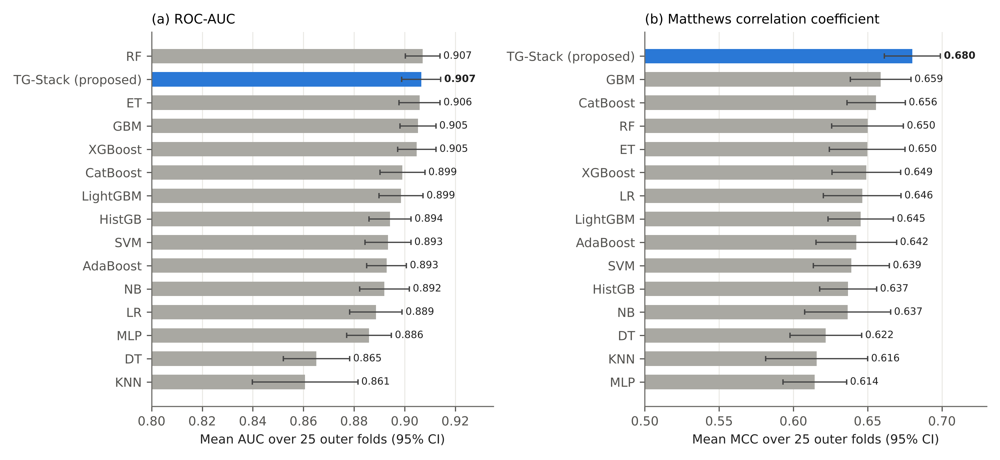
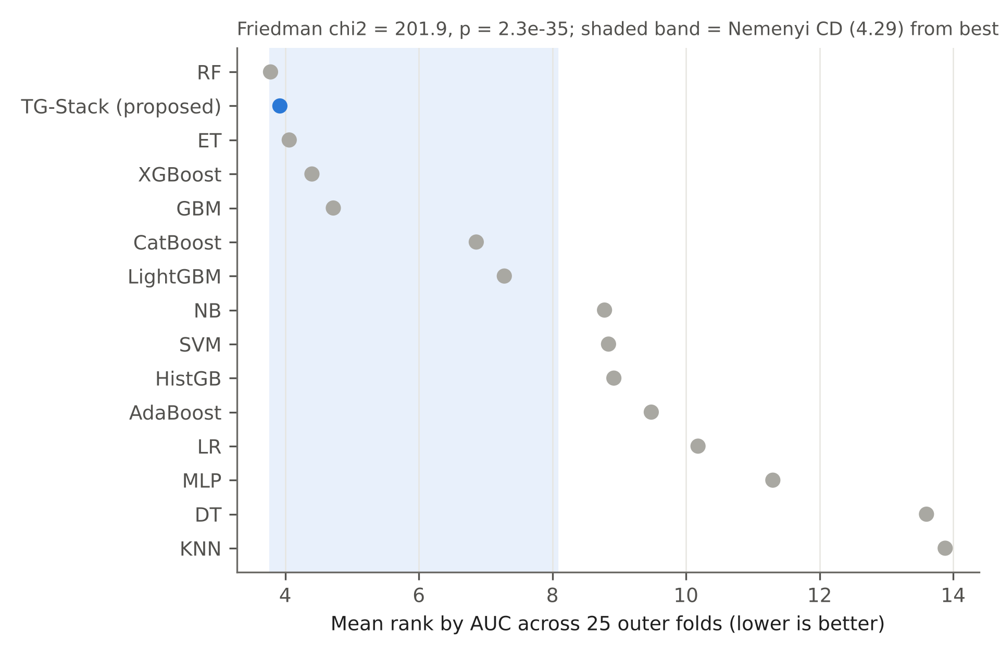
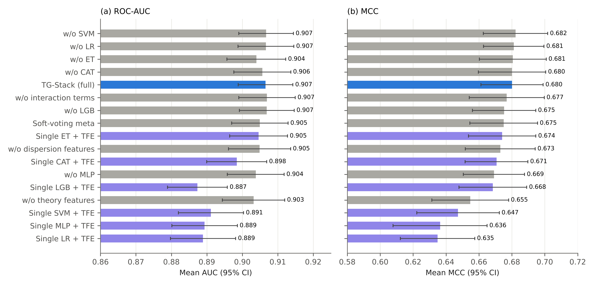
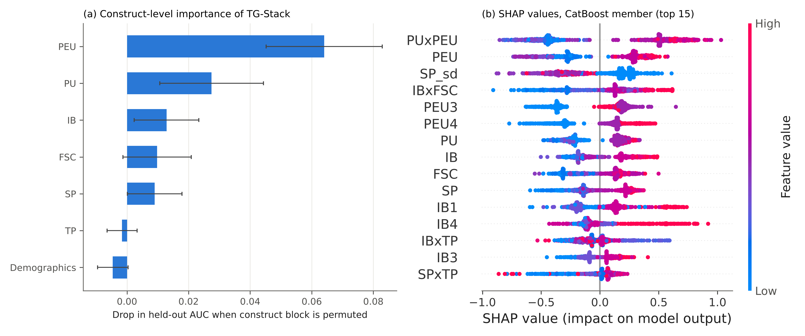

# Results

All numbers below are copied from the manuscript (Tables 4, 6-11) and were produced by this code on the real
dataset (n = 757) in the pinned environment (`requirements-paper.txt`). Mean (SD) over 5 x 5 repeated stratified
group cross-validation unless stated otherwise. Re-generate them with `tg-stack --data <csv> --out results`;
the CSV/JSON files written to `results/` correspond to these tables.

## Measurement model (Table 4 - stage `sem`)

All constructs meet the usual reliability/convergent-validity thresholds (Cronbach's alpha and CR > 0.70, AVE > 0.50).
All HTMT ratios are below 0.90 (maximum 0.898, PEU-AUB) but six exceed 0.85, indicating high inter-construct overlap
(consistent with straight-lining and common-method variance).

| Construct | Items | Loadings | Cronbach's alpha | CR | AVE | Max HTMT |
|---|:-:|:-:|:-:|:-:|:-:|:-:|
| PU | 4 | 0.849-0.870 | 0.922 | 0.922 | 0.748 | 0.880 |
| PEU | 4 | 0.824-0.883 | 0.912 | 0.912 | 0.722 | 0.898 |
| FSC | 3 | 0.847-0.888 | 0.905 | 0.905 | 0.761 | 0.880 |
| SP | 4 | 0.738-0.822 | 0.866 | 0.867 | 0.619 | 0.867 |
| TP | 3 | 0.818-0.838 | 0.867 | 0.868 | 0.686 | 0.847 |
| IB | 4 | 0.709-0.805 | 0.859 | 0.861 | 0.608 | 0.786 |
| AUB | 4 | 0.750-0.842 | 0.879 | 0.881 | 0.649 | 0.898 |

## Structural model (Table 6 - stage `sem`)

Standardised equally weighted composites, OLS, 5,000 bootstrap resamples. R² = 0.565 (intention) and 0.632 (actual use).

| Path | β | Bootstrap SE | t | p | 95% CI | R2 (DV) | Supported |
|---|:-:|:-:|:-:|:-:|:-:|:-:|:-:|
| PU → IB | 0.117 | 0.056 | 2.06 | 0.039 | [0.006, 0.228] | 0.565 | Yes |
| PEU → IB | 0.294 | 0.071 | 4.15 | < 0.001 | [0.149, 0.425] | 0.565 | Yes |
| FSC → IB | 0.075 | 0.058 | 1.29 | 0.196 | [-0.042, 0.186] | 0.565 | No |
| SP → IB | 0.105 | 0.054 | 1.97 | 0.049 | [0.002, 0.212] | 0.565 | Yes |
| TP → IB | 0.253 | 0.048 | 5.32 | < 0.001 | [0.162, 0.348] | 0.565 | Yes |
| IB → AUB | 0.287 | 0.047 | 6.08 | < 0.001 | [0.197, 0.379] | 0.632 | Yes |
| FSC → AUB | 0.45 | 0.044 | 10.12 | < 0.001 | [0.366, 0.542] | 0.632 | Yes |
| TP → AUB | 0.152 | 0.042 | 3.61 | < 0.001 | [0.068, 0.231] | 0.632 | Yes |

## Predictive benchmark (Table 7 - stage `main`)

TG-Stack: fixed hyper-parameters. Baselines: nested-tuned (randomised search, 10 draws, inner 3-fold stratified group CV,
AUC criterion). Rows ordered by MCC.

| Model | Family | Accuracy | Precision | Recall | F1 | AUC | MCC | Kappa | Brier |
|---|:-:|:-:|:-:|:-:|:-:|:-:|:-:|:-:|:-:|
| TG-Stack (proposed) | Hybrid stacking | 0.840 (0.024) | 0.839 (0.030) | 0.841 (0.035) | 0.839 (0.025) | 0.907 (0.020) | 0.680 (0.048) | 0.679 (0.049) | 0.121 (0.015) |
| GBM | Boosting | 0.828 (0.027) | 0.809 (0.035) | 0.860 (0.036) | 0.833 (0.025) | 0.905 (0.018) | 0.659 (0.052) | 0.656 (0.053) | 0.139 (0.009) |
| CatBoost | Boosting | 0.827 (0.026) | 0.819 (0.038) | 0.842 (0.036) | 0.829 (0.024) | 0.899 (0.023) | 0.656 (0.050) | 0.654 (0.051) | 0.125 (0.016) |
| RF | Bagging | 0.824 (0.031) | 0.806 (0.039) | 0.854 (0.042) | 0.829 (0.030) | 0.907 (0.017) | 0.650 (0.062) | 0.647 (0.063) | 0.123 (0.014) |
| ET | Bagging | 0.823 (0.033) | 0.802 (0.037) | 0.859 (0.044) | 0.829 (0.032) | 0.906 (0.021) | 0.650 (0.065) | 0.647 (0.065) | 0.127 (0.014) |
| XGBoost | Boosting | 0.824 (0.030) | 0.814 (0.034) | 0.841 (0.042) | 0.826 (0.030) | 0.905 (0.019) | 0.649 (0.059) | 0.648 (0.059) | 0.123 (0.014) |
| LR | Linear | 0.821 (0.033) | 0.794 (0.035) | 0.869 (0.036) | 0.829 (0.032) | 0.889 (0.026) | 0.646 (0.067) | 0.643 (0.067) | 0.145 (0.016) |
| LightGBM | Boosting | 0.822 (0.028) | 0.817 (0.039) | 0.832 (0.037) | 0.824 (0.028) | 0.899 (0.022) | 0.645 (0.056) | 0.644 (0.057) | 0.128 (0.015) |
| AdaBoost | Boosting | 0.817 (0.037) | 0.779 (0.044) | 0.889 (0.032) | 0.830 (0.031) | 0.893 (0.020) | 0.642 (0.069) | 0.634 (0.074) | 0.148 (0.014) |
| SVM | Kernel | 0.818 (0.033) | 0.797 (0.036) | 0.855 (0.044) | 0.824 (0.032) | 0.893 (0.023) | 0.639 (0.065) | 0.636 (0.066) | 0.129 (0.018) |
| HistGB | Boosting | 0.817 (0.025) | 0.799 (0.035) | 0.849 (0.039) | 0.822 (0.024) | 0.894 (0.021) | 0.637 (0.049) | 0.634 (0.050) | 0.136 (0.018) |
| NB | Probabilistic | 0.816 (0.037) | 0.782 (0.039) | 0.876 (0.039) | 0.826 (0.034) | 0.892 (0.025) | 0.637 (0.074) | 0.631 (0.075) | 0.174 (0.036) |
| DT | Tree | 0.810 (0.031) | 0.805 (0.045) | 0.822 (0.045) | 0.812 (0.029) | 0.865 (0.034) | 0.622 (0.062) | 0.620 (0.062) | 0.144 (0.019) |
| KNN | Instance | 0.799 (0.044) | 0.746 (0.038) | 0.909 (0.067) | 0.818 (0.045) | 0.861 (0.053) | 0.616 (0.088) | 0.599 (0.088) | 0.152 (0.036) |
| MLP | Neural | 0.805 (0.028) | 0.807 (0.041) | 0.806 (0.074) | 0.804 (0.034) | 0.886 (0.023) | 0.614 (0.055) | 0.610 (0.056) | 0.149 (0.014) |

Friedman test over the 15 models: chi² = 201.9, p = 2.3e-35; Nemenyi CD = 4.29.

## Significance tests (Table 8 - stage `main`)

Mean difference (TG-Stack minus baseline) with Nadeau-Bengio corrected p-values in brackets; * p < 0.05.

| Baseline | ΔAUC (p) | ΔAccuracy (p) | ΔF1 (p) | ΔMCC (p) |
|---|:-:|:-:|:-:|:-:|
| LR | +0.018 (0.008)* | +0.018 (0.087) | +0.010 (0.314) | +0.034 (0.108) |
| NB | +0.015 (0.073) | +0.024 (0.042)* | +0.013 (0.200) | +0.043 (0.058) |
| KNN | +0.046 (0.077) | +0.040 (0.039)* | +0.021 (0.309) | +0.064 (0.091) |
| DT | +0.041 (0.003)* | +0.030 (0.065) | +0.028 (0.067) | +0.058 (0.071) |
| SVM | +0.013 (0.016)* | +0.022 (0.029)* | +0.015 (0.115) | +0.041 (0.038)* |
| MLP | +0.021 (0.003)* | +0.035 (0.009)* | +0.036 (0.035)* | +0.066 (0.010)* |
| RF | -0.001 (0.913) | +0.016 (0.132) | +0.011 (0.274) | +0.030 (0.149) |
| ET | +0.001 (0.864) | +0.016 (0.115) | +0.010 (0.262) | +0.030 (0.135) |
| AdaBoost | +0.014 (0.028)* | +0.022 (0.125) | +0.010 (0.448) | +0.038 (0.165) |
| GBM | +0.001 (0.824) | +0.012 (0.293) | +0.006 (0.529) | +0.021 (0.316) |
| HistGB | +0.012 (0.029)* | +0.023 (0.014)* | +0.017 (0.056) | +0.043 (0.017)* |
| XGBoost | +0.002 (0.719) | +0.016 (0.117) | +0.013 (0.188) | +0.031 (0.121) |
| LightGBM | +0.008 (0.133) | +0.018 (0.112) | +0.016 (0.143) | +0.035 (0.117) |
| CatBoost | +0.007 (0.085) | +0.013 (0.090) | +0.010 (0.111) | +0.024 (0.086) |

## Ablation (Table 9 - stage `ablation`)

TFE = theory-guided feature engineering. Removing all theory-guided features gives the largest loss (MCC -0.025,
p = 0.078, not individually significant); interactions and dispersion features are largely redundant once the construct
composites are present; no single base learner is indispensable.

| Variant | Accuracy | F1 | AUC | MCC | Brier | ΔAUC vs full | ΔMCC vs full |
|---|:-:|:-:|:-:|:-:|:-:|:-:|:-:|
| TG-Stack (full) | 0.840 (0.024) | 0.839 (0.025) | 0.907 (0.020) | 0.680 (0.048) | 0.121 (0.015) | – | – |
| w/o theory features | 0.827 (0.030) | 0.829 (0.030) | 0.903 (0.022) | 0.655 (0.060) | 0.124 (0.017) | -0.0034 (p=0.315) | -0.0254 (p=0.078) |
| w/o interaction terms | 0.838 (0.029) | 0.838 (0.029) | 0.907 (0.020) | 0.677 (0.058) | 0.121 (0.016) | +0.0004 (p=0.868) | -0.0032 (p=0.777) |
| w/o dispersion features | 0.836 (0.027) | 0.837 (0.027) | 0.905 (0.022) | 0.673 (0.054) | 0.121 (0.016) | -0.0017 (p=0.577) | -0.0072 (p=0.633) |
| Soft-voting meta | 0.837 (0.027) | 0.838 (0.027) | 0.905 (0.020) | 0.675 (0.052) | 0.120 (0.015) | -0.0016 (p=0.557) | -0.0051 (p=0.652) |
| w/o LR | 0.840 (0.024) | 0.840 (0.024) | 0.907 (0.020) | 0.681 (0.047) | 0.121 (0.015) | +0.0001 (p=0.917) | +0.0010 (p=0.772) |
| w/o SVM | 0.841 (0.025) | 0.841 (0.026) | 0.907 (0.020) | 0.682 (0.050) | 0.121 (0.015) | +0.0001 (p=0.711) | +0.0021 (p=0.435) |
| w/o ET | 0.840 (0.026) | 0.840 (0.027) | 0.904 (0.021) | 0.681 (0.052) | 0.122 (0.016) | -0.0026 (p=0.395) | +0.0004 (p=0.958) |
| w/o CAT | 0.840 (0.026) | 0.839 (0.026) | 0.906 (0.020) | 0.680 (0.052) | 0.121 (0.015) | -0.0009 (p=0.527) | +0.0000 (p=0.998) |
| w/o LGB | 0.837 (0.025) | 0.837 (0.025) | 0.907 (0.020) | 0.675 (0.049) | 0.121 (0.015) | +0.0003 (p=0.715) | -0.0048 (p=0.486) |
| w/o MLP | 0.834 (0.024) | 0.834 (0.024) | 0.904 (0.020) | 0.669 (0.047) | 0.121 (0.015) | -0.0028 (p=0.349) | -0.0110 (p=0.303) |
| Single LR + TFE | 0.816 (0.029) | 0.821 (0.029) | 0.889 (0.023) | 0.635 (0.058) | 0.132 (0.017) | -0.0176 (p=0.020) | -0.0453 (p=0.022) |
| Single SVM + TFE | 0.823 (0.032) | 0.824 (0.032) | 0.891 (0.023) | 0.647 (0.064) | 0.127 (0.016) | -0.0154 (p=0.033) | -0.0328 (p=0.046) |
| Single ET + TFE | 0.836 (0.026) | 0.836 (0.026) | 0.905 (0.021) | 0.674 (0.052) | 0.123 (0.013) | -0.0020 (p=0.513) | -0.0060 (p=0.625) |
| Single CAT + TFE | 0.835 (0.024) | 0.835 (0.025) | 0.898 (0.022) | 0.671 (0.049) | 0.125 (0.016) | -0.0081 (p=0.057) | -0.0094 (p=0.563) |
| Single LGB + TFE | 0.834 (0.026) | 0.834 (0.027) | 0.887 (0.022) | 0.668 (0.053) | 0.130 (0.018) | -0.0192 (p=0.004) | -0.0117 (p=0.557) |
| Single MLP + TFE | 0.817 (0.037) | 0.822 (0.035) | 0.889 (0.024) | 0.636 (0.073) | 0.135 (0.016) | -0.0172 (p=0.005) | -0.0437 (p=0.077) |

## Robustness (Table 10 - stage `robust`)

R1: straight-liners and exact duplicates removed (n = 591). R2: outcome threshold AUB >= 3.75. All models in these
scenarios use default (untuned) settings, so margins are not comparable to the nested-tuned benchmark.

| Scenario | Model | Accuracy | F1 | AUC | MCC | TG-Stack gain (AUC / MCC) |
|---|:-:|:-:|:-:|:-:|:-:|:-:|
| R1 cleaned (n=591) | TG-Stack (proposed) | 0.789 | 0.782 | 0.863 | 0.579 | – |
| R1 cleaned (n=591) | CatBoost | 0.783 | 0.779 | 0.854 | 0.568 | +0.009 / +0.012 |
| R1 cleaned (n=591) | SVM | 0.773 | 0.768 | 0.842 | 0.547 | +0.021 / +0.033 |
| R1 cleaned (n=591) | LightGBM | 0.771 | 0.766 | 0.835 | 0.543 | +0.028 / +0.037 |
| R1 cleaned (n=591) | ET | 0.765 | 0.756 | 0.821 | 0.530 | +0.042 / +0.049 |
| R1 cleaned (n=591) | LR | 0.762 | 0.759 | 0.833 | 0.525 | +0.030 / +0.054 |
| R1 cleaned (n=591) | XGBoost | 0.754 | 0.746 | 0.819 | 0.508 | +0.043 / +0.071 |
| R2 threshold AUB≥3.75 | TG-Stack (proposed) | 0.835 | 0.861 | 0.904 | 0.661 | – |
| R2 threshold AUB≥3.75 | SVM | 0.830 | 0.857 | 0.887 | 0.650 | +0.017 / +0.011 |
| R2 threshold AUB≥3.75 | CatBoost | 0.821 | 0.849 | 0.893 | 0.634 | +0.011 / +0.028 |
| R2 threshold AUB≥3.75 | LR | 0.822 | 0.850 | 0.885 | 0.633 | +0.019 / +0.028 |
| R2 threshold AUB≥3.75 | LightGBM | 0.806 | 0.835 | 0.864 | 0.602 | +0.040 / +0.060 |
| R2 threshold AUB≥3.75 | XGBoost | 0.798 | 0.827 | 0.852 | 0.586 | +0.052 / +0.076 |
| R2 threshold AUB≥3.75 | ET | 0.752 | 0.792 | 0.807 | 0.491 | +0.097 / +0.170 |

## Leakage experiment (Table 11 - stage `leak`)

| Model | Split scheme | Accuracy | AUC | MCC | R2 (continuous AUB) | Optimism of naive split |
|---|:-:|:-:|:-:|:-:|:-:|:-:|
| TG-Stack | Naive stratified k-fold | 0.835 (0.024) | 0.910 (0.024) | 0.672 (0.048) | – | ΔAUC = +0.004; ΔMCC = -0.008 |
| TG-Stack | Duplicate-aware group k-fold | 0.840 (0.024) | 0.907 (0.020) | 0.680 (0.048) | – |  |
| Random forest (default) | Naive stratified k-fold | 0.825 (0.029) | 0.900 (0.023) | 0.653 (0.058) | – | ΔAUC = +0.049; ΔMCC = +0.085 |
| Random forest (default) | Duplicate-aware group k-fold | 0.780 (0.064) | 0.852 (0.048) | 0.568 (0.122) | – |  |
| Random-forest regression | Naive k-fold | – | – | – | 0.682 (0.052) | dR2 = +0.049 |
| Random-forest regression | Duplicate-aware group k-fold | – | – | – | 0.633 (0.074) |  |

## Explainability (Figure 6 - stage `explain`)

Construct-level grouped permutation importance (drop in held-out AUC): ease of use 0.064, usefulness 0.027, intention
0.013, facilitating conditions 0.010, social presence 0.009, trust -0.002, demographics -0.005. Top SHAP features of the
CatBoost member: PU x PEU (mean |SHAP| 0.531), PEU composite (0.340), dispersion of social-presence items (0.267),
IB x FSC (0.260).

